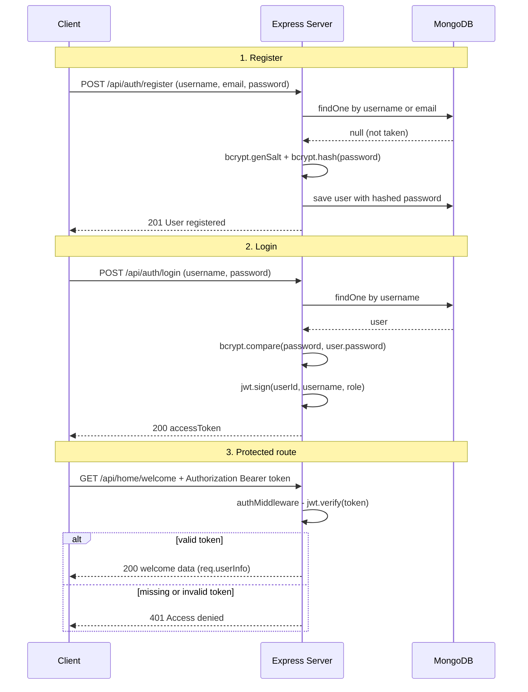

> **Source:** `7. nodejs-auth` (`models/User.js`, `controllers/auth-controller.js`, `middleware/auth-middleware.js`)

## Authentication vs authorization

| | Question | Failure code |
|-|-|-|
| **Authentication** | *Who are you?* (valid login / token) | `401` |
| **Authorization**  | *Are you allowed to do this?* (role/ownership) | `403` |

## The flow

<Steps>
<Step>
**Register**: the client sends `username, email, password`. The server hashes the password with **bcrypt** and saves the user.
</Step>
<Step>
**Login**: the server finds the user and compares the password with the hash. If it matches, it **signs a JWT** with `userId, username, role`.
</Step>
<Step>
**Access protected routes**: the client sends `Authorization: Bearer <token>`. The **auth middleware** verifies the token and attaches the decoded data to `req.userInfo`.
</Step>
</Steps>



## User model

```js title="models/User.js"
const mongoose = require("mongoose");

const UserSchema = new mongoose.Schema(
  {
    username: { type: String, required: true, unique: true, trim: true },
    email: { type: String, required: true, unique: true, trim: true, lowercase: true },
    password: { type: String, required: true },
    role: {
      type: String,
      enum: ["user", "admin"], // only allow 'user' or 'admin' roles
      default: "user",
    },
  },
  { timestamps: true } // adds createdAt & updatedAt automatically
);

module.exports = mongoose.model("User", UserSchema);
```

## Register

```js title="controllers/auth-controller.js"
const User = require("../models/User");
const bcrypt = require("bcryptjs");
const jwt = require("jsonwebtoken");

const registerUser = async (req, res) => {
  try {
    const { username, email, password, role } = req.body;

    // check if the user already exists (same username OR email)
    const checkExistingUser = await User.findOne({ $or: [{ username }, { email }] });
    if (checkExistingUser) {
      return res.status(400).json({
        success: false,
        message:
          "User is already exists either with same username or same email. Please try with a different username or email",
      });
    }

    // hash user password
    const salt = await bcrypt.genSalt(10);
    const hashedPassword = await bcrypt.hash(password, salt);

    // create a new user and save in database
    const newlyCreatedUser = new User({
      username,
      email,
      password: hashedPassword,
      role: role || "user",
    });
    await newlyCreatedUser.save();

    res.status(201).json({ success: true, message: "User registered successfully!" });
  } catch (e) {
    console.log(e);
    res.status(500).json({ success: false, message: "Some error occured! Please try again" });
  }
};
```

<Callout title="Why hash?">
  Never store plain passwords. `bcrypt.genSalt(10)` creates a random salt (10 = cost rounds), and
  `bcrypt.hash()` produces a one-way hash. You can't reverse a hash. You can only **compare**
  against it.
</Callout>

## Login

```js
const loginUser = async (req, res) => {
  try {
    const { username, password } = req.body;

    // does the user exist?
    const user = await User.findOne({ username });
    if (!user) {
      return res.status(400).json({ success: false, message: `User doesn't exists` });
    }

    // is the password correct?
    const isPasswordMatch = await bcrypt.compare(password, user.password);
    if (!isPasswordMatch) {
      return res.status(400).json({ success: false, message: "Invalid credentials!" });
    }

    // create user token
    const accessToken = jwt.sign(
      { userId: user._id, username: user.username, role: user.role }, // payload
      process.env.JWT_SECRET_KEY,                                     // secret
      { expiresIn: "30m" }                                            // options
    );

    res.status(200).json({ success: true, message: "Logged in successful", accessToken });
  } catch (e) {
    console.log(e);
    res.status(500).json({ success: false, message: "Some error occured! Please try again" });
  }
};
```

<Callout type="warn">
  A JWT payload is **encoded, not encrypted**. Anyone can decode it, so never put passwords or
  secrets in it. The signature only stops it from being **tampered with**.
</Callout>

## Auth middleware

```js title="middleware/auth-middleware.js"
const jwt = require("jsonwebtoken");

const authMiddleware = (req, res, next) => {
  const authHeader = req.headers["authorization"]; // "Bearer <token>"
  const token = authHeader && authHeader.split(" ")[1];

  if (!token) {
    return res.status(401).json({
      success: false,
      message: "Access denied. No token provided. Please login to continue",
    });
  }

  try {
    const decodedTokenInfo = jwt.verify(token, process.env.JWT_SECRET_KEY);
    req.userInfo = decodedTokenInfo; // { userId, username, role, iat, exp }
    next();
  } catch (error) {
    return res.status(401).json({
      success: false,
      message: "Access denied. Invalid or expired token. Please login to continue",
    });
  }
};

module.exports = authMiddleware;
```

<Callout title="Note">
  The original code returns `500` with the "no token" message when verification fails. An invalid
  or expired token is really a `401`, as shown above.
</Callout>

## Routes

```js title="routes/auth-routes.js"
const express = require("express");
const { registerUser, loginUser, changePassword } = require("../controllers/auth-controller");
const authMiddleware = require("../middleware/auth-middleware");
const router = express.Router();

router.post("/register", registerUser);
router.post("/login", loginUser);
router.post("/change-password", authMiddleware, changePassword);

module.exports = router;
```

```js title="routes/home-routes.js"
const express = require("express");
const authMiddleware = require("../middleware/auth-middleware");
const router = express.Router();

router.get("/welcome", authMiddleware, (req, res) => {
  const { username, userId, role } = req.userInfo;

  res.json({
    message: "Welcome to the home page",
    user: { _id: userId, username, role },
  });
});

module.exports = router;
```

## Testing in Postman

1. `POST /api/auth/register` with body `{ "username", "email", "password", "role"? }`
2. `POST /api/auth/login` and copy `accessToken`
3. `GET /api/home/welcome` with the header `Authorization: Bearer <accessToken>`

## Quick recap

- Register: check duplicates (`$or`), then `bcrypt.genSalt` + `bcrypt.hash`, then save.
- Login: `findOne`, then `bcrypt.compare`, then `jwt.sign(payload, secret, { expiresIn })`.
- Protect routes with a middleware: read the `Bearer` token, `jwt.verify`, set `req.userInfo`, call `next()`.
