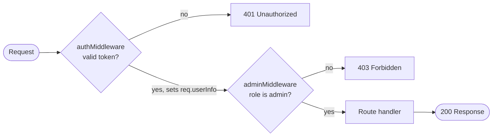

> **Source:** `7. nodejs-auth` (`middleware/admin-middleware.js`, `routes/admin-routes.js`)

Once a user is **authenticated**, `req.userInfo.role` tells us **what they may do**. The `role` comes from the JWT payload, which was set from the `User.role` field (`"user"` or `"admin"`).

## Admin middleware

```js title="middleware/admin-middleware.js"
const isAdminUser = (req, res, next) => {
  if (req.userInfo.role !== "admin") {
    return res.status(403).json({
      success: false,
      message: "Access denied! Admin rights required.",
    });
  }

  next();
};

module.exports = isAdminUser;
```

## Chaining middlewares

The order matters: `authMiddleware` must run **first**, because it's what sets `req.userInfo`.

```js title="routes/admin-routes.js"
const express = require("express");
const authMiddleware = require("../middleware/auth-middleware");
const adminMiddleware = require("../middleware/admin-middleware");

const router = express.Router();

router.get("/welcome", authMiddleware, adminMiddleware, (req, res) => {
  res.json({ message: "Welcome to the admin page" });
});

module.exports = router;
```



<Callout>
  To test it, register a user with `"role": "admin"`, log in, and call `GET /api/admin/welcome`
  with that token. A normal user's token gets `403`.
</Callout>

## Quick recap

- Put the role in the JWT payload at login.
- Check it in a separate middleware and return `403` if it's not allowed.
- Chain them: `router.get(path, auth, admin, handler)`.
