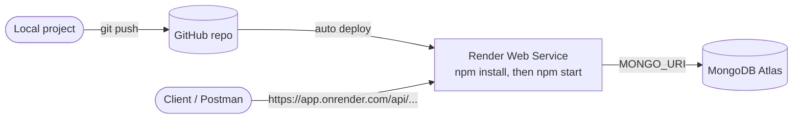

**Render** runs your Express app as a normal, long-running **Web Service**, just like `npm start` on your machine. Unlike Vercel, no extra config file is needed.



## Prepare the project

<Steps>
<Step>
Add a `start` script that runs the server with **node** (not nodemon):

```json title="package.json"
"scripts": {
  "start": "node server.js",
  "dev": "nodemon server.js"
}
```
</Step>
<Step>
Read the port from the environment. Render sets `PORT` itself:

```js title="server.js"
const PORT = process.env.PORT || 3000;
```
</Step>
<Step>
Make sure `.env` and `node_modules` are in `.gitignore`, then push the project to GitHub.
</Step>
</Steps>

## Create the Web Service

<Steps>
<Step>On [render.com](https://render.com): **New → Web Service**, then connect your GitHub repo.</Step>
<Step>
Fill in the settings:

| Setting         | Value                                         |
| --------------- | --------------------------------------------- |
| Root Directory  | Project folder (if the repo has many projects) |
| Runtime         | Node                                          |
| Build Command   | `npm install`                                 |
| Start Command   | `npm start`                                   |
| Instance Type   | Free                                          |
</Step>
<Step>
Add **Environment Variables**, using the same keys as `.env` (`MONGO_URI`, `JWT_SECRET_KEY`, `CLOUDINARY_*`). You don't need to add `PORT`.
</Step>
<Step>
In MongoDB Atlas → Network Access, allow `0.0.0.0/0` so Render can connect.
</Step>
<Step>
Click **Create Web Service**, watch the logs, then test the `https://<app>.onrender.com` URL in Postman. Every new push to the branch redeploys automatically.
</Step>
</Steps>

<Callout type="warn" title="Free tier notes">
  - The service **sleeps after inactivity**, so the first request after a while is slow (cold start).
  - The disk is **ephemeral**: files saved to `uploads/` disappear on redeploy or restart. That's
    fine here, because images go to Cloudinary.
</Callout>

## Render vs Vercel

|                    | Render                          | Vercel                                  |
| ------------------ | ------------------------------- | --------------------------------------- |
| How Express runs   | Long-running server             | Serverless function                     |
| Config file        | None (dashboard settings)       | `vercel.json`                           |
| WebSockets (Socket.IO) | ✅ Supported                | ❌ Not suited (serverless)              |
| Free tier catch    | Sleeps when idle                | Function time limits, read-only disk    |

## Quick recap

- `start` script runs `node server.js`, and the port comes from `process.env.PORT`.
- New Web Service → build `npm install` → start `npm start` → add env vars.
- Allow Atlas network access. Pushing to GitHub redeploys automatically.
