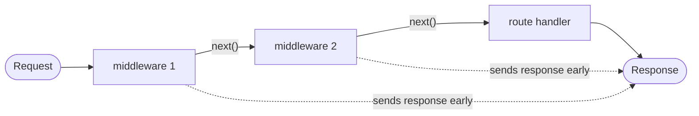

> **Source:** `2. express-tutorial` (`middleware.js`, `custom-middleware.js`)

## What is middleware?

A **middleware** is a function `(req, res, next)` that runs **before** the route handler. It can:

- read or modify `req` / `res`
- end the request early (e.g. `res.status(401).json(...)`)
- call `next()` to pass control to the next middleware or route



<Callout type="warn">
  If a middleware neither sends a response nor calls `next()`, the request **hangs**.
</Callout>

## Global middleware

`app.use(fn)` runs `fn` on **every** request.

```js title="middleware.js"
const express = require("express");
const app = express();

// define middleware function
const myFirstMiddleware = (req, res, next) => {
  console.log("this first middleware will run on every request");
  next();
};

app.use(myFirstMiddleware);

app.get("/", (req, res) => res.send("Home page"));
app.get("/about", (req, res) => res.send("About page"));

app.listen(3000, () => console.log("Server is now running on port 3000"));
```

## Custom middleware: request logger

```js title="custom-middleware.js"
const requestTimestampLogger = (req, res, next) => {
  const timeStamp = new Date().toISOString();
  console.log(`${timeStamp} from ${req.method} to ${req.url}`);
  next();
};

app.use(requestTimestampLogger);
```

## Kinds of middleware used in this course

| Kind             | Example                                      | Where             |
| ---------------- | -------------------------------------------- | ----------------- |
| Built-in         | `express.json()`: parses JSON into `req.body` | REST API, all APIs |
| Built-in         | `express.static("public")`: serves static files | Socket.IO chat |
| Custom global    | Logger above                                 | `app.use(fn)`     |
| Route-level      | `router.get("/x", authMiddleware, handler)`  | [Auth](/docs/part-1/auth-and-file-upload/authentication) |
| Error-handling   | `(err, req, res, next) => {}`                | [Express basics](/docs/part-1/express/express-basics) |

## Quick recap

- Signature: `(req, res, next)`. Always call `next()` or send a response.
- `app.use(fn)` = every request. Passing it as a route argument = that route only.
- Middleware runs in the order it's registered.
