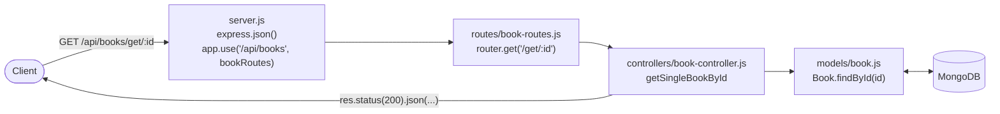

> **Source:** `6. bookstore-api`

This project turns the [in-memory REST API](/docs/part-1/express/rest-api) into a proper **MongoDB-backed** API using an MVC-style folder structure. **Use it as a template for new projects.**

## Folder structure

<Files>
  <Folder name="6. bookstore-api" defaultOpen>
    <Folder name="controllers" defaultOpen>
      <File name="book-controller.js" />
    </Folder>
    <Folder name="database" defaultOpen>
      <File name="db.js" />
    </Folder>
    <Folder name="models" defaultOpen>
      <File name="book.js" />
    </Folder>
    <Folder name="routes" defaultOpen>
      <File name="book-routes.js" />
    </Folder>
    <File name=".env" />
    <File name="server.js" />
    <File name="package.json" />
  </Folder>
</Files>

| Layer        | Responsibility                                  |
| ------------ | ----------------------------------------------- |
| `server.js`  | App setup: env, DB connection, middleware, routes |
| `database/`  | DB connection logic                             |
| `models/`    | Mongoose schemas (data shape + validation)      |
| `controllers/` | Business logic for each endpoint              |
| `routes/`    | Maps URLs + methods → controller functions      |



## Setup

```bash
npm i express mongoose dotenv
npm i -D nodemon
```

```json title="package.json (scripts)"
"scripts": {
  "start": "node server.js",
  "dev": "nodemon server.js"
}
```

```ini title=".env"
PORT=3000
MONGO_URI=mongodb+srv://<user>:<password>@<cluster>.mongodb.net/
```

## 1. Database connection

```js title="database/db.js"
const mongoose = require("mongoose");

const connectToDB = async () => {
  try {
    await mongoose.connect(process.env.MONGO_URI);
    console.log("mongodb is connected successfully !");
  } catch (error) {
    console.error("Mongodb connection failed", error);
    process.exit(1); // stop the app if DB is unreachable
  }
};

module.exports = connectToDB;
```

## 2. Model with validation

```js title="models/book.js"
const mongoose = require("mongoose");

const BookSchema = new mongoose.Schema({
  title: {
    type: String,
    required: [true, "Book title is required"],
    trim: true,
    maxLength: [100, "Book title can not be more than 100 characters"],
  },
  author: {
    type: String,
    required: [true, "Author name is required"],
    trim: true,
  },
  year: {
    type: Number,
    required: [true, "Publication year is required"],
    min: [1000, "Year must be atleast 1000"],
    max: [new Date().getFullYear(), "Year cannot be in the future"],
  },
  createdAt: {
    type: Date,
    default: Date.now,
  },
});

module.exports = mongoose.model("Book", BookSchema);
```

| Validator      | Meaning                                        |
| -------------- | ---------------------------------------------- |
| `required: [true, msg]` | Field must be present (custom message) |
| `trim: true`   | Remove surrounding whitespace                  |
| `maxLength`    | Max string length                              |
| `min` / `max`  | Number range                                   |
| `default`      | Value used if not provided                     |

## 3. Controllers

All controllers follow the same pattern: `try` → DB call → `404` if not found → `200/201` success, and `catch` → `500`.

```js title="controllers/book-controller.js"
const Book = require("../models/book");

const getAllBooks = async (req, res) => {
  try {
    const allBooks = await Book.find({});
    if (allBooks?.length > 0) {
      res.status(200).json({
        success: true,
        message: "List of books fetched successfully",
        data: allBooks,
      });
    } else {
      res.status(404).json({ success: false, message: "No books found in collection" });
    }
  } catch (e) {
    console.log(e);
    res.status(500).json({ success: false, message: "Something went wrong! Please try again" });
  }
};

const getSingleBookById = async (req, res) => {
  try {
    const bookDetailsByID = await Book.findById(req.params.id);

    if (!bookDetailsByID) {
      return res.status(404).json({
        success: false,
        message: "Book with the current ID is not found! Please try with a different ID",
      });
    }

    res.status(200).json({ success: true, data: bookDetailsByID });
  } catch (e) {
    console.log(e);
    res.status(500).json({ success: false, message: "Something went wrong! Please try again" });
  }
};

const addNewBook = async (req, res) => {
  try {
    const newlyCreatedBook = await Book.create(req.body);
    res.status(201).json({
      success: true,
      message: "Book added successfully",
      data: newlyCreatedBook,
    });
  } catch (e) {
    console.log(e);
    res.status(500).json({ success: false, message: "Something went wrong! Please try again" });
  }
};

const updateBook = async (req, res) => {
  try {
    const updatedBook = await Book.findByIdAndUpdate(req.params.id, req.body, { new: true });

    if (!updatedBook) {
      return res.status(404).json({ success: false, message: "Book is not found with this ID" });
    }

    res.status(200).json({
      success: true,
      message: "Book updated successfully",
      data: updatedBook,
    });
  } catch (e) {
    console.log(e);
    res.status(500).json({ success: false, message: "Something went wrong! Please try again" });
  }
};

const deleteBook = async (req, res) => {
  try {
    const deletedBook = await Book.findByIdAndDelete(req.params.id);

    if (!deletedBook) {
      return res.status(404).json({ success: false, message: "Book is not found with this ID" });
    }

    res.status(200).json({ success: true, data: deletedBook });
  } catch (e) {
    console.log(e);
    res.status(500).json({ success: false, message: "Something went wrong! Please try again" });
  }
};

module.exports = { getAllBooks, getSingleBookById, addNewBook, updateBook, deleteBook };
```

<Callout type="warn" title="Always `return` after sending an error response">
  The original `updateBook` / `deleteBook` send a 404 **without** `return`, so the code goes on
  and tries to send a 200 as well. That causes `Cannot set headers after they are sent`. The
  versions above add `return`.
</Callout>

## 4. Routes (express.Router)

```js title="routes/book-routes.js"
const express = require("express");
const {
  getAllBooks,
  getSingleBookById,
  updateBook,
  deleteBook,
  addNewBook,
} = require("../controllers/book-controller");

// create express router
const router = express.Router();

router.get("/get", getAllBooks);
router.get("/get/:id", getSingleBookById);
router.post("/add", addNewBook);
router.put("/update/:id", updateBook);
router.delete("/delete/:id", deleteBook);

module.exports = router;
```

## 5. Server entry

```js title="server.js"
require("dotenv").config(); // must be first, loads .env into process.env
const express = require("express");
const connectToDB = require("./database/db");
const bookRoutes = require("./routes/book-routes");

const app = express();
const PORT = process.env.PORT || 3000;

// connect to our database
connectToDB();

// middleware
app.use(express.json());

// routes, mounted with a prefix
app.use("/api/books", bookRoutes);

app.listen(PORT, () => console.log(`Server is now running on port ${PORT}`));
```

Final endpoints: `GET /api/books/get`, `GET /api/books/get/:id`, `POST /api/books/add`, `PUT /api/books/update/:id`, `DELETE /api/books/delete/:id`.

## Quick recap

- Split into `models / controllers / routes / database`, with `server.js` wiring them together.
- `express.Router()` plus `app.use("/api/books", router)` for prefixed routes.
- Put schema validation in the model. Secrets go in `.env` via `dotenv`.
- Use a consistent response shape: `{ success, message, data }`.
