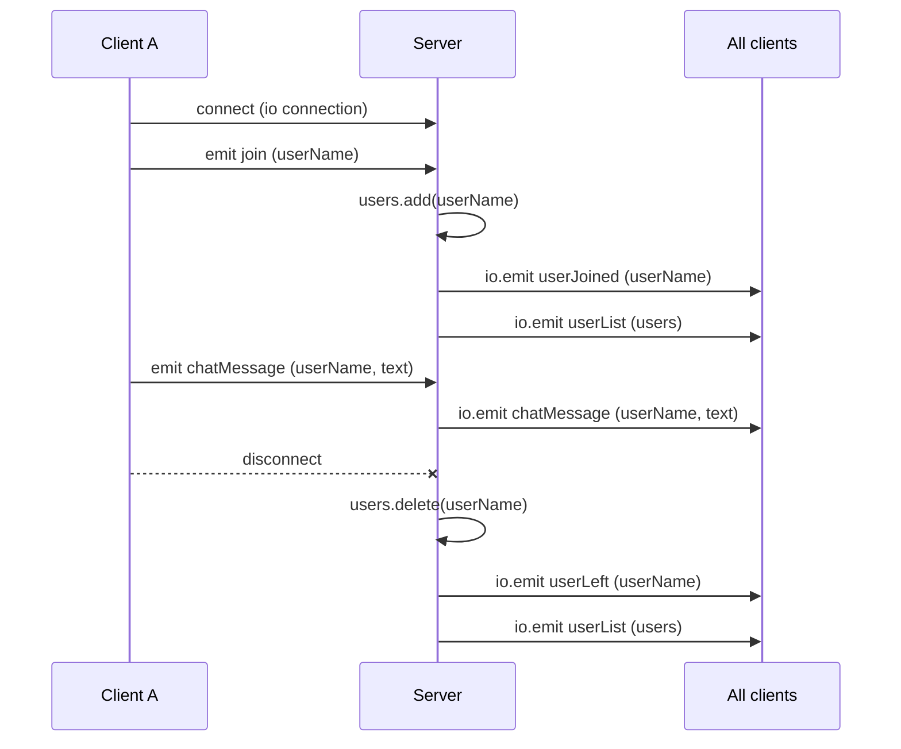

> **Source:** `9. nodejs-socket`

## Why sockets?

With HTTP, the **client asks** and the server answers, and that's it. With **WebSockets**, a connection stays open and **either side can send data at any time**. That's what chat, notifications, live dashboards and multiplayer games need.

**Socket.IO** wraps WebSockets with an easy **event** API (`on` / `emit`, like the [Event Emitter](/docs/part-1/async-javascript/event-emitter)).

```bash
npm i express socket.io
```

## Emit cheatsheet

| Call                     | Sends to                               |
| ------------------------ | -------------------------------------- |
| `socket.emit(evt, data)` | Only this one client (or server, from the client) |
| `io.emit(evt, data)`     | **All** connected clients              |
| `socket.on(evt, fn)`     | Listen for an event from that client   |
| `io.on("connection", fn)`| Runs for each new client               |
| `"disconnect"`           | Built-in event when a client leaves    |

## Events in this app

| Event         | Direction        | Payload                 |
| ------------- | ---------------- | ----------------------- |
| `join`        | client → server  | `userName`              |
| `userJoined`  | server → all     | `userName`              |
| `userList`    | server → all     | `string[]`              |
| `chatMessage` | both ways        | `{ userName, text }`    |
| `userLeft`    | server → all     | `userName`              |



## Server

```js title="server.js"
const express = require("express");
const http = require("http");
const socketIo = require("socket.io");

const app = express();
const server = http.createServer(app);

// initiate socket.io and attach it to the http server
const io = socketIo(server);

app.use(express.static("public")); // serves public/index.html

const users = new Set();

io.on("connection", (socket) => {
  console.log("A user is now connected");

  // handle users when they join the chat
  socket.on("join", (userName) => {
    users.add(userName);
    socket.userName = userName;

    // broadcast to all clients that a new user has joined
    io.emit("userJoined", userName);

    // send the updated user list to all clients
    io.emit("userList", Array.from(users));
  });

  // handle incoming chat message
  socket.on("chatMessage", (message) => {
    // broadcast the received message to all connected clients
    io.emit("chatMessage", message);
  });

  // handle user disconnection
  socket.on("disconnect", () => {
    console.log("An User is disconnected", socket.userName);

    users.forEach((user) => {
      if (user === socket.userName) {
        users.delete(user);
        io.emit("userLeft", user);
        io.emit("userList", Array.from(users));
      }
    });
  });
});

const PORT = 3000;
server.listen(PORT, () => {
  console.log(`Server is now running on http://localhost:${PORT}`);
});
```

<Callout>
  Socket.IO attaches to the **http server**, not the Express `app`. That's why we create
  `http.createServer(app)` and call `server.listen()` instead of `app.listen()`.
</Callout>

## Client

```html title="public/index.html"
<!DOCTYPE html>
<html lang="en">
  <head>
    <meta charset="UTF-8" />
    <meta name="viewport" content="width=device-width, initial-scale=1.0" />
    <title>Chat App</title>
  </head>
  <body>
    <div id="user-list">
      <h3>Online Users</h3>
      <ul id="users"></ul>
    </div>
    <div id="chat"></div>
    <form id="message-form">
      <input type="text" id="message-input" placeholder="Enter your message" required />
      <button type="submit">Send</button>
    </form>

    <!-- served automatically by socket.io -->
    <script src="/socket.io/socket.io.js"></script>
    <script>
      const socket = io();

      const chat = document.getElementById("chat");
      const usersList = document.getElementById("users");
      const messageForm = document.getElementById("message-form");
      const messageInput = document.getElementById("message-input");

      const userName = prompt("Enter your username");
      socket.emit("join", userName);

      socket.on("userJoined", (user) => addMessage(`${user} has joined the chat`));
      socket.on("userLeft", (user) => addMessage(`${user} has left the chat`));

      socket.on("userList", (users) => {
        usersList.innerHTML = users.map((user) => `<li>${user}</li>`).join("");
      });

      // listen for chatMessage events from the server
      socket.on("chatMessage", (message) => {
        addMessage(`${message.userName}: ${message.text}`);
      });

      // handle form submission
      messageForm.addEventListener("submit", (event) => {
        event.preventDefault();
        const text = messageInput.value.trim();
        if (text) {
          socket.emit("chatMessage", { userName, text });
          messageInput.value = "";
        }
      });

      function addMessage(input) {
        const messageElement = document.createElement("div");
        messageElement.textContent = input;
        chat.appendChild(messageElement);
        chat.scrollTop = chat.scrollHeight; // scroll to bottom
      }
    </script>
  </body>
</html>
```

Open `http://localhost:3000` in two browser tabs to watch messages arrive in real time.

## Quick recap

- `const io = socketIo(http.createServer(app))`, then `server.listen()`
- `io.on("connection", socket => { socket.on(...) })`
- `socket.emit` = one client, `io.emit` = everyone. Clean up on `"disconnect"`.
